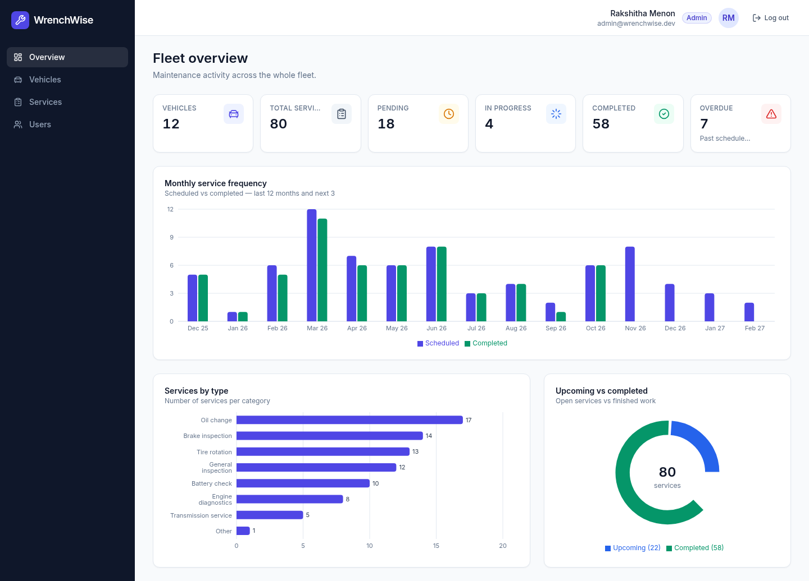
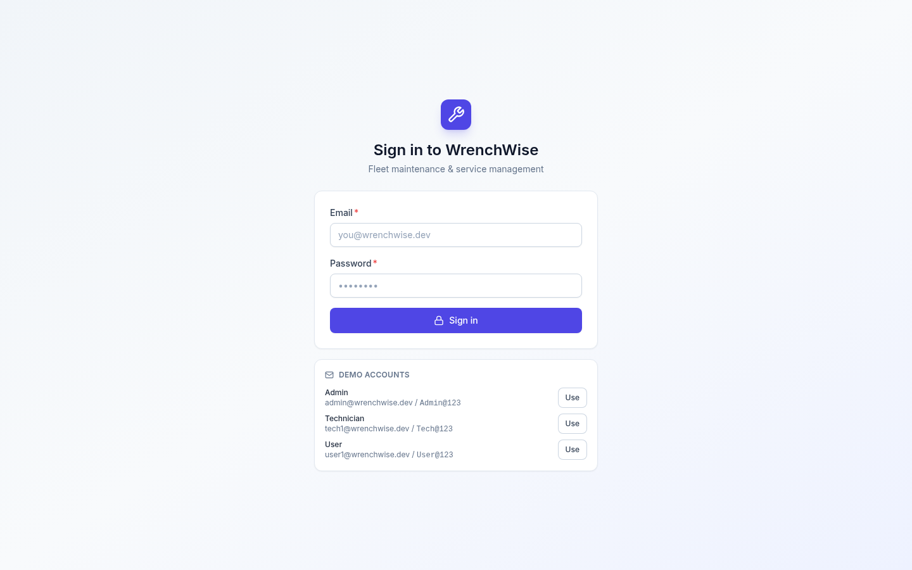
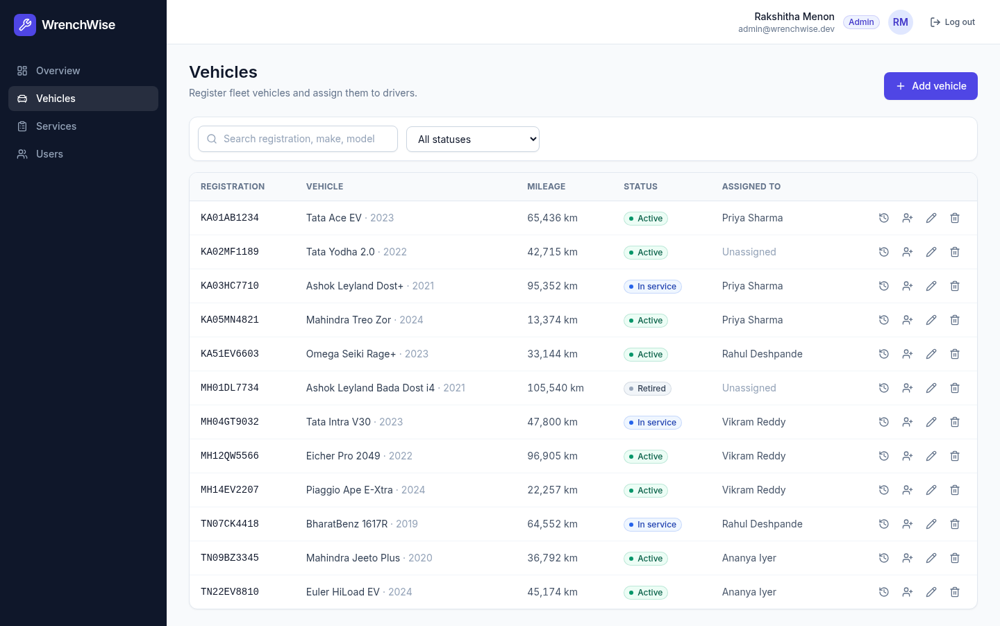
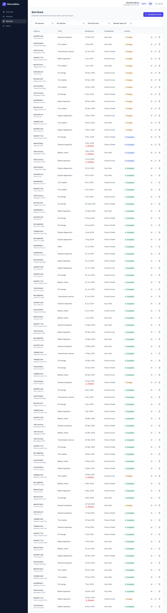
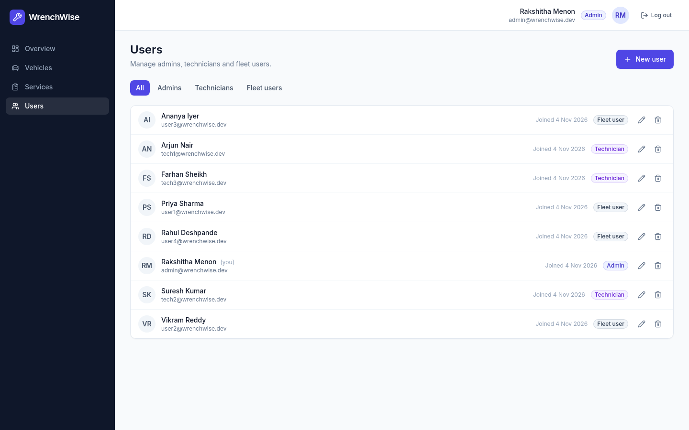
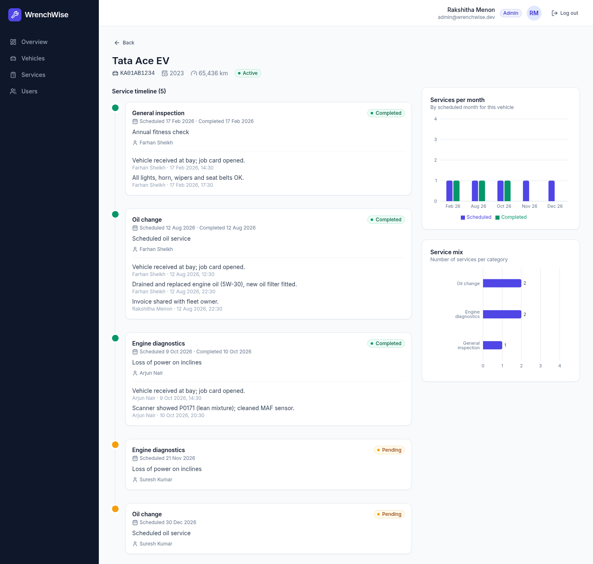
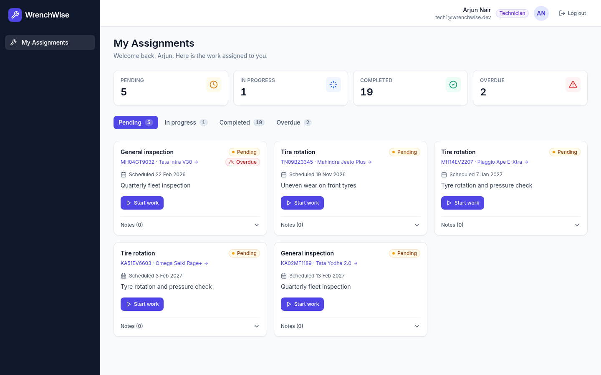
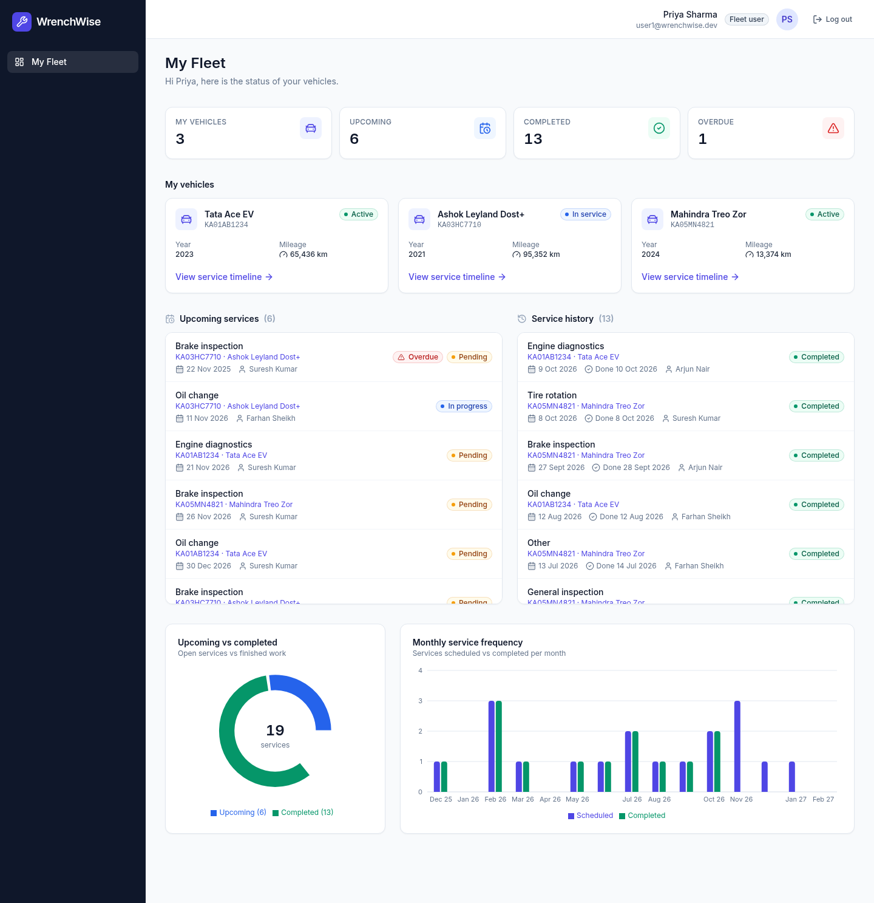
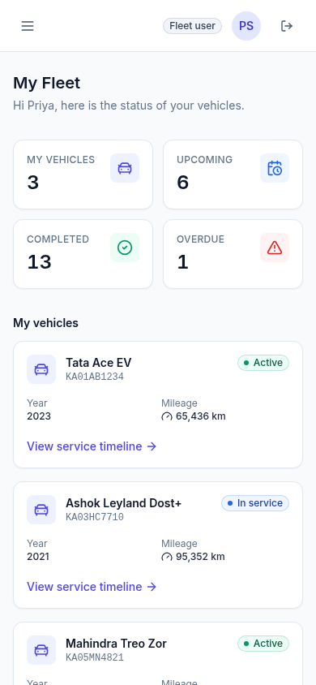

# WrenchWise: Fleet Maintenance & Service Management

WrenchWise is a full-stack system for managing a vehicle fleet's maintenance. Admins schedule services and assign them to technicians, technicians work through their queue, and vehicle owners track upcoming and completed services. It has a JWT-secured REST API with role-based access control and a role-aware React dashboard with charts.



## Tech stack

| Layer     | Choice |
|-----------|--------|
| Backend   | Node.js 20+, Express 5, Mongoose 9, zod (validation), bcrypt, jsonwebtoken, helmet, express-rate-limit |
| Database  | MongoDB 7 (Docker) |
| Frontend  | React 18, TypeScript (strict), Vite, React Router 6, TanStack Query 5, Tailwind CSS, Recharts |
| Testing   | Jest + Supertest + mongodb-memory-server (79 API tests) |

## Features by role

| Role | Can do |
|------|--------|
| **Admin** | Fleet overview KPIs and charts · create, edit and delete vehicles · assign and unassign vehicles to users · create, assign, edit and delete service schedules · view all service records with filters · manage users (admins, technicians, users) |
| **Technician** | See only the services assigned to them, grouped as pending, in progress, completed and overdue · move a service through `pending → in-progress → completed` (or back to pending) · add service notes |
| **User** | See their assigned vehicles · see upcoming services and completed service history · per-vehicle maintenance timeline · personal service charts |

**Data visualisation**
- monthly service frequency (scheduled vs completed, last 12 months plus the next 3)
- services by type
- upcoming vs completed donut
- per-vehicle maintenance timeline with its own monthly and type charts

All charts respect the caller's role scope.

## Getting started

### Prerequisites
- Node.js 20 or newer (developed on Node 24)
- Docker (for MongoDB), or a local MongoDB 6+ on `27017`

### 1. Start MongoDB
```bash
docker compose up -d mongo
```

### 2. Backend
```bash
cd backend
cp .env.example .env          # then set JWT_SECRET to a long random string
npm install
npm run seed                  # wipes and loads demo data
npm run dev                   # http://localhost:5000/api
```

### 3. Frontend
```bash
cd frontend
npm install
npm run dev                   # http://localhost:5174
```
Vite proxies `/api` to `localhost:5000`, so the auth cookie is same-origin.

### Tests and build
```bash
cd backend && npm test        # 79 API tests on an in-memory MongoDB
cd frontend && npm run build  # type-check + production build
```

## Demo credentials

Loaded by `npm run seed`. The login page also has one-click buttons that fill them in.

| Role       | Email                                   | Password   |
|------------|-----------------------------------------|------------|
| Admin      | `admin@wrenchwise.dev`                  | `Admin@123` |
| Technician | `tech1@wrenchwise.dev` (also `tech2`, `tech3`) | `Tech@123` |
| User       | `user1@wrenchwise.dev` (also `user2`–`user4`)  | `User@123` |

The seed is deterministic: 8 users, 12 vehicles and 80 services spread over the past 12 months and the next 3, with a mix of completed, in-progress, pending and overdue work.

## Environment variables (`backend/.env`)

| Variable         | Default                                   | Purpose |
|------------------|-------------------------------------------|---------|
| `MONGODB_URI`    | `mongodb://127.0.0.1:27017/wrenchwise`     | Mongo connection string (required) |
| `JWT_SECRET`     | –                                         | HMAC secret for signing tokens (required) |
| `JWT_EXPIRES_IN` | `8h`                                      | Token lifetime |
| `PORT`           | `5000`                                    | API port |
| `CLIENT_ORIGIN`  | `http://localhost:5174`                    | Allowed CORS origin |
| `NODE_ENV`       | `development`                             | `production` enables the `Secure` cookie flag |

## Authentication & RBAC

- `POST /api/auth/login` verifies the password against a bcrypt hash (cost 12) and signs a JWT with payload `{ sub: userId, role }`.
- The token is set as an **httpOnly, SameSite=Strict cookie** (`ww_token`), so frontend JavaScript can never read it. It is also returned in the body for API clients, which can send `Authorization: Bearer <token>`.
- The `authenticate` middleware verifies the token and reloads the user, so deleted users and role changes take effect immediately. `authorize(...roles)` then guards each route.
- Ownership scoping lives in the service layer: technicians only see their assigned services, and users only see services on their own vehicles. Records outside your scope return `404`, so their existence isn't revealed.
- Login is rate-limited, and unknown emails still run a bcrypt comparison, so response timing doesn't reveal which emails exist.
- On the frontend, `ProtectedRoute` checks the session (restored with `GET /auth/me`) and the role. The sidebar navigation is rendered per role, and any `401` logs the user out and redirects to `/login`.

## API documentation

The full reference is in **[docs/API.md](docs/API.md)**: endpoints, request and response shapes, status codes, the error format and scoping rules. Quick map:

| Area | Endpoints | Access |
|------|-----------|--------|
| Auth | `POST /auth/login`, `POST /auth/logout`, `GET /auth/me` | public / authenticated |
| Users | `GET/POST /users`, `GET/PATCH/DELETE /users/:id` | admin |
| Vehicles | `GET/POST /vehicles`, `GET/PATCH/DELETE /vehicles/:id`, `PATCH /vehicles/:id/assign` | admin |
| Services | `GET/POST /services`, `GET/PATCH/DELETE /services/:id` | read: scoped to every role · write: admin |
| Status | `PATCH /services/:id/status` | assigned technician |
| Notes | `POST /services/:id/notes` | assigned technician, admin |
| Me | `GET /me/vehicles`, `GET /me/services?scope=upcoming\|history` | user (vehicles), user & technician (services) |
| Stats | `GET /stats/summary`, `GET /stats/vehicles/:id/timeline` | all roles, scoped |

Example:
```bash
TOKEN=$(curl -s -X POST localhost:5000/api/auth/login -H 'Content-Type: application/json' \
  -d '{"email":"admin@wrenchwise.dev","password":"Admin@123"}' | jq -r .token)
curl -s localhost:5000/api/stats/summary -H "Authorization: Bearer $TOKEN" | jq .totals
```

## Project structure

```
backend/
  src/
    app.js, server.js        Express app factory and entry point
    config/                  env validation, Mongo connection
    middleware/              authenticate/authorize, zod validate, rate limit, error handler
    routes/ → controllers/ → services/ → models/
    validators/              zod request schemas
    utils/                   ApiError, password hashing
  scripts/seed.js            deterministic demo data
  tests/                     Jest + Supertest suites per resource
frontend/
  src/
    api/                     typed fetch client and endpoint modules
    context/, hooks/         auth context, react-query hooks and mutations
    routes/                  AppRoutes, ProtectedRoute
    layouts/                 responsive sidebar and top bar
    pages/admin|technician|user|shared
    components/, components/charts/
docs/
  API.md                     API reference
  screenshots/
```

## Screenshots

| | |
|---|---|
| **Login**  | **Admin – vehicles**  |
| **Admin – services**  | **Admin – users**  |
| **Vehicle timeline**  | **Technician – assignments**  |
| **User dashboard**  | **Mobile**  |

Mobile captures of every page are in [docs/screenshots](docs/screenshots).
